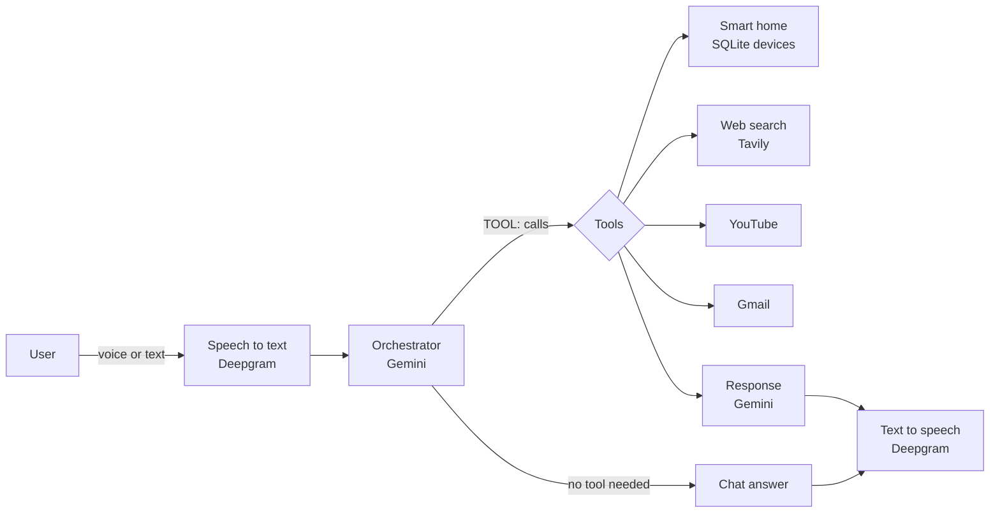

# Living Smarter


An LLM-powered voice assistant for a simulated smart home. An orchestrator
built on Google Gemini understands natural commands, splits them into tasks
and runs them with tools: smart-home devices, web search, YouTube and Gmail.

It is the prototype behind the research paper *Living Smarter: An AI Voice
Assistant for Home Automation* (Hochschule Bremen, [read the paper](docs/paper.pdf)),
which asked:

1. How accurately can a Gemini-powered assistant understand and execute commands?
2. How does the LLM help with multi-turn dialogue?
3. How well does it handle multi-step tasks across devices and services?

## Results

The paper tested the assistant with 36 commands and scored each answer by hand:

| | Result |
|---|---|
| Understood the request | 36 / 36 (100%) |
| Did the right task | 26 / 36 (72%) |

Simple commands worked reliably; most mistakes happened in commands with
several steps.

A rerun with `gemini-3.5-flash-lite` chose the right tools for all of the
first 14 commands, including three that failed in the paper (the free quota
stopped the run there). See [Evaluation](#evaluation) to rerun it.

## How it works



1. **The orchestrator** reads the command with the last turns of the
   conversation and either answers directly or returns one `TOOL:` call per
   task, in the order they must run.
2. **The tools run.** For devices, a second model call matches a description
   like "the bedroom" to real devices in the simulated home (37 devices:
   lights, TVs, thermostats, doors, cameras, plugs…).
3. **The response step** turns the tool results into one natural answer.

## Tech stack

- **Python 3.13**, Google Gemini, Tavily, Deepgram, Gmail API, Selenium
- **SQLite** for the simulated smart home
- **uv** (locked dependencies), **Ruff**, **pytest**
- **GitHub Actions** (lint and tests on every pull request), **Docker**

## Getting started

You need [uv](https://docs.astral.sh/uv/) and a
[Gemini API key](https://aistudio.google.com/apikey).

```bash
git clone https://github.com/oussama-abid/living-smarter.git
cd living-smarter
cp .env.example .env      # add GEMINI_API_KEY
uv sync
uv run python main.py
```

The device database is created on the first start. Other keys are optional,
and each one unlocks a feature (see `.env.example`):

| Setting | Feature |
|---|---|
| `GEMINI_API_KEY` | required |
| `TAVILY_API_KEY` | web search (weather, news, activities) |
| `DEEPGRAM_API_KEY` | voice input and output |
| OAuth files in `secrets/` | Gmail: create a "Desktop app" OAuth client with the Gmail API enabled in Google Cloud and save it as `secrets/credentials.json` |

**Voice mode** needs PortAudio for the microphone
(`sudo apt install portaudio19-dev` on Ubuntu), then `uv sync --extra voice`.

### Docker

```bash
docker build -t living-smarter .
docker run -it --rm --env-file .env -v living-smarter-data:/data living-smarter
```

Text mode only; the device states are kept in the `living-smarter-data` volume.

## Evaluation

```bash
uv run python -m evaluation.run
```

This reruns the 36 commands of the original test
([`evaluation/cases.json`](evaluation/cases.json)) against the real model:

- Gemini makes every decision for real. Email, YouTube and web search are
  replaced by recorders, and the smart home runs on a temporary database, so
  a run sends no email and changes nothing.
- Each command is scored automatically: did the assistant call the tools it
  needs? `evaluation/results.md` puts today's result next to the paper's for
  every command, with the full replies for review by hand.
- A pause between commands respects the free-tier rate limit (`--pause`).
  A full run needs about 100 requests; with a small daily quota, run one
  category at a time (`--category multi-step`).

The paper used `gemini-2.5-flash`, which is no longer available. The model is
configurable (`GEMINI_MODEL`), so results from newer models can differ.

## Development

```bash
uv run ruff check && uv run ruff format --check
uv run pytest
```

The tests replace Gemini with a fake model, so they run offline in about a
second and need no API key. They cover the smart-home tool on a temporary
database and the orchestrator's routing, including malformed or unknown
tool calls.

```
agents/            orchestrator: tool decision, tool execution, responses
tools/             smart home, web search, YouTube, Gmail
db/                simulated smart-home devices (SQLite)
prompts/           prompts for the orchestrator and the tools
speech_processing/ Deepgram speech to text and text to speech
evaluation/        the 36 test commands and the evaluation script
tests/             unit tests with a fake model
config.py          all settings, loaded from .env
```

## Credits

Research and paper by **Oussama Ben Abid** and **Manel Khammari**,
Hochschule Bremen. Prototype developed by **Oussama Ben Abid**.

The version evaluated in the paper is tagged
[`v0.1-paper`](https://github.com/oussama-abid/living-smarter/tree/v0.1-paper).
