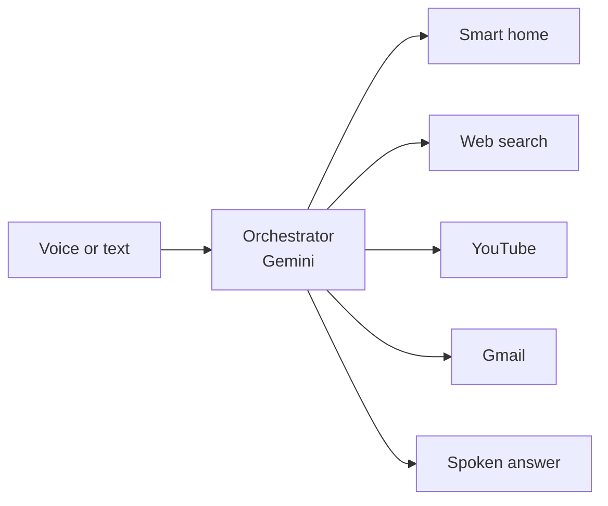

# Living Smarter


A voice assistant for a simulated smart home. You speak or type normally, and
Google Gemini decides what to do: switch devices, search the web, play
YouTube videos, or read and send Gmail.

It was built for the research paper *Living Smarter: An AI Voice Assistant
for Home Automation* at Hochschule Bremen.

## Results

The paper tested the assistant with 36 commands, scored by hand:

- **Understood the request:** 36 / 36
- **Did the right task:** 26 / 36 (72%)

Simple commands worked reliably. Most mistakes happened in commands with
several steps.

A rerun with `gemini-3.5-flash-lite` chose the right tools for all of the
first 14 commands (the free quota stopped it there), including three that
failed in the paper.

## How it works



The orchestrator splits a command into tasks, runs the matching tools, and
turns the results into one answer. The smart home is a SQLite database with
37 devices.

## Run it

You need [uv](https://docs.astral.sh/uv/) and a
[Gemini API key](https://aistudio.google.com/apikey).

```bash
git clone https://github.com/oussama-abid/living-smarter.git
cd living-smarter
cp .env.example .env      # add your GEMINI_API_KEY
uv sync
uv run python main.py
```

Optional:

- **Web search:** add `TAVILY_API_KEY`
- **Voice:** add `DEEPGRAM_API_KEY`, install PortAudio, then `uv sync --extra voice`
- **Gmail:** save a Google OAuth client file as `secrets/credentials.json`

With Docker (text mode):

```bash
docker build -t living-smarter .
docker run -it --rm --env-file .env -v living-smarter-data:/data living-smarter
```

## Evaluation

```bash
uv run python -m evaluation.run
```

Reruns the 36 test commands from the paper. Email, YouTube and web search are
only recorded, never executed. The results, next to the paper's, are written
to `evaluation/results.md`.

## Tests

```bash
uv run pytest
```

The tests use a fake model, so they run offline without an API key.

## Credits

Research and paper by **Oussama Ben Abid** and **Manel Khammari**,
Hochschule Bremen. Prototype by **Oussama Ben Abid**. The version from the
paper is tagged
[`v0.1-paper`](https://github.com/oussama-abid/living-smarter/releases/tag/v0.1-paper).
